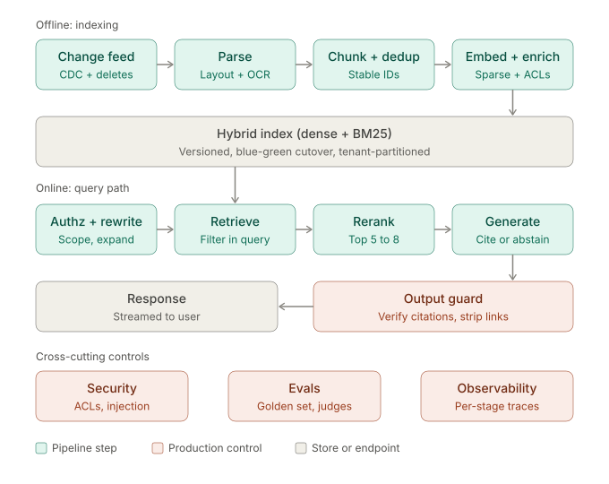
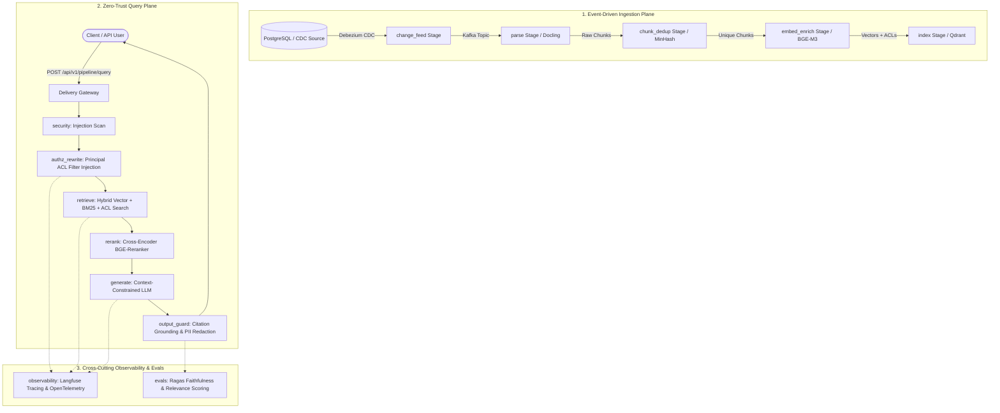

# Enterprise Production RAG Pipeline

A production-grade, zero-trust, multi-tenant Retrieval-Augmented Generation (RAG) platform built for high concurrency, verifiable zero data leakage, and automated compliance.



---

## 1. What This Is & Why It Is Critically Important

Traditional or naive RAG architectures suffer from five fatal flaws when deployed in enterprise production:
1. **Access Control Leakage (Cross-Tenant & Cross-Role Data Breaches)**: Standard vector databases index all documents uniformly. Without query-time authorization enforcement, users routinely retrieve sensitive HR, financial, executive, or customer records they are unauthorized to see.
2. **Hallucination & Fabricated Answers**: LLMs generate plausible-sounding falsehoods without verifiable citation attribution.
3. **Indirect Prompt Injection & Jailbreaks**: Untrusted corporate documents (emails, tickets, scraped PDFs) ingested into the vector database can contain adversarial instructions that hijack the model during generation.
4. **Data Staleness & Index Drift**: Batch scraping fails to capture document updates, permission revocations, or deletes in real time, causing stale or revoked data to be served.
5. **Lack of Operational Determinism**: Ad-hoc scripts lack audit logging, distributed tracing, circuit breakers, and schema validation.

### How This Pipeline Solves Them
- **Zero-Trust Query Rewriting (`authz_rewrite`)**: Injects deterministic ACL filters directly into the retrieval query before vector search, mathematically guaranteeing zero cross-tenant or unauthorized data exposure.
- **Strict Citation Attestation (`output_guard`)**: Validates that every claim and generated token maps directly to retrieved chunk identifiers (`[doc:v:c0000]`). Unattributed claims are blocked or redacted.
- **Proactive Threat Neutralization (`security`)**: Pre-retrieval and pre-generation sanitization guards against direct and indirect prompt injection attempts.
- **Event-Driven Change Data Capture (`change_feed`)**: Debezium and Kafka stream database transactions and ACL updates in real time, propagating soft/hard deletions instantly.
- **RFC 9457 & Strict Pydantic Contracts**: Enforces `extra="forbid"` and `strict=True` across all DTOs and APIs to prevent silent type coercion or schema drift.

---

## 2. End-to-End Workflow: How It Works

The platform operates across two asynchronous, decoupled lifecycles: **The Ingestion Plane** and **The Query & Generation Plane**.



### Stage-by-Stage Breakdown

| Stage | Canonical Role | Mechanism & Technology |
|---|---|---|
| **1. `change_feed`** | Event Streaming | Consumes real-time database CDC events via Debezium and Kafka. Distinguishes `INSERT`, `UPDATE`, and `DELETE` mutations to trigger downstream re-indexing or vector purging. |
| **2. `parse`** | Document Conversion | Converts heterogeneous multi-format documents (PDFs, DOCX, Markdown, HTML, Scans) into structured token streams using Docling with OCR fallback. |
| **3. `chunk_dedup`** | Tokenization & Deduplication | Performs structural semantic chunking with overlapping windows and eliminates duplicate passages using MinHash LSH and content hashes. |
| **4. `embed_enrich`** | Semantic Representation | Computes dense multi-lingual vectors via BGE-M3 / Qwen3-Embedding served on Hugging Face Text Embeddings Inference (TEI), enriched with document lineage and security tags. |
| **5. `index`** | Vector Storage | Stores vectors, payload metadata, and tenant ACL bitmasks in distributed Qdrant with sharding, replication, and WAL durability. |
| **6. `security`** | Threat Screening | Detects adversarial prompt injection, jailbreaks, and system override patterns in both incoming user queries and retrieved external contexts. |
| **7. `authz_rewrite`** | Deterministic Security Filter | Inspects caller identity, tenant isolation, and group memberships. Injects mandatory ACL boolean filter clauses into the query payload before vector retrieval. |
| **8. `retrieve`** | Hybrid Search | Executes hybrid semantic (cosine) and lexical (BM25) search against Qdrant, filtered strictly by the user's authorized ACL scope. |
| **9. `rerank`** | Precision Filtering | Re-scores retrieved candidate chunks using a cross-encoder (BGE-Reranker-v2) on dedicated GPU pools to isolate top-$K$ relevance. |
| **10. `generate`** | Constrained Synthesis | Synthesizes answers using vLLM (Qwen3 / OSS models) under strict system constraints requiring explicit bracketed chunk citations (e.g. `[doc1:v1:c0001]`). |
| **11. `output_guard`** | Hallucination & PII Defense | Verifies that all citations correspond to actual retrieved context, redacts PII, and suppresses ungrounded claims. |
| **12. `evals`** | Continuous Quality Gates | Evaluates faithfulness, context recall, and answer relevance via Ragas scoring. |
| **13. `observability`** | Distributed Tracing | Records W3C distributed trace spans across all stages into Langfuse and OpenTelemetry sinks. |

---

## 3. Where Others Can Use This Platform

This architecture is reusable across mission-critical enterprise domains requiring strict security, compliance, and zero data leakage:

### Enterprise Internal Knowledge Bases & Intranets
- **Scenario**: Employees querying internal confluence, HR handbooks, engineering wikis, and executive memos.
- **Why here**: Guarantees regular employees cannot discover executive compensation, confidential M&A documents, or private personnel files, even if those documents reside in the shared vector index.

### Regulated Financial & Banking Services
- **Scenario**: Financial analysts and relationship managers querying SEC filings, credit risk assessments, customer portfolios, and underwriting guidelines.
- **Why here**: Provides auditable citation tracking, tamper-proof access control logs, and PII redaction required by FINRA, SEC, and GDPR.

### Healthcare & Clinical Decision Support
- **Scenario**: Physicians and researchers querying clinical trials, patient histories, drug interaction databases, and treatment protocols.
- **Why here**: Grounded citations eliminate fabricated medical claims; tenant and role isolation enforces HIPAA compliance.

### Multi-Tenant SaaS & Customer Support Automation
- **Scenario**: B2B SaaS applications providing an embedded AI copilot across multiple enterprise customers.
- **Why here**: Native tenant isolation (`tenant_id`) enforced at the database RLS, vector payload, and query rewrite layers prevents cross-tenant data leaks.

### Legal Discovery & Contract Analysis
- **Scenario**: Law firms and corporate legal teams searching thousands of contracts, litigation filings, and NDAs.
- **Why here**: Precise cross-encoder reranking extracts needle-in-haystack clauses; output guardrails ensure verbatim grounding against contract source paragraphs.

---

## 4. Production Open-Source Stack Matrix

| Layer | Component | License | Scaling Strategy |
|---|---|---|---|
| **Change feed** | Debezium → Kafka | Apache 2.0 | Partitions plus consumer groups |
| **Parse** | Docling (Unstructured OSS fallback) | MIT / Apache 2.0 | Stateless CPU/GPU workers pulling from Kafka |
| **Pipeline framework** | Haystack | Apache 2.0 | Stateless query-service pods |
| **Embedding model** | BGE-M3 or Qwen3-Embedding | MIT / Apache 2.0 | GPU pools via Hugging Face TEI |
| **Embedding + rerank serving** | Hugging Face TEI | Apache 2.0 | GPU pods behind HPA |
| **Rerank model** | bge-reranker-v2-m3 or Qwen3-Reranker | Apache 2.0 | Dedicated TEI pool |
| **Index** | Qdrant (distributed mode) | Apache 2.0 | Sharding plus replication |
| **Generation model** | Qwen3 or gpt-oss | Apache 2.0 | High-throughput LLM serving via vLLM |
| **Generation serving** | vLLM | Apache 2.0 | GPU pods, tensor parallelism |
| **Cache** | Valkey | BSD | Cluster mode with AOF/RDB recovery |
| **Guardrails** | NeMo Guardrails | Apache 2.0 | Sidecar or dedicated gateway |
| **Evals** | Ragas | Apache 2.0 | Automated CI/CD regression testing |
| **Tracing** | Langfuse + OpenTelemetry | MIT | Distributed W3C trace context, ClickHouse/PostgreSQL sink |
| **Orchestration** | Kubernetes + KEDA | Apache 2.0 | Event-driven autoscaling on Kafka consumer lag |

---

## 5. Repository Structure

```
├── README.md                     # High-level overview, architecture, and deployment guide
├── rag-pipeline.md               # Production controls, failure modes, and engineering specification
├── rag_pipeline.svg              # System architecture diagram
├── policies/                     # Organization-wide architectural rules (submodule)
└── rag-pipeline/                 # Core service package root
    ├── config/                   # Declarative configuration and environment schemas
    ├── contracts/                # OpenAPI 3.1, gRPC Proto, and AsyncAPI specifications
    ├── database/                 # Migrations, rollback scripts, RLS policies, topology
    ├── messaging/                # Topics, policies, DLQs, event schemas
    ├── deploy/                   # Deployment manifests
    │   ├── argocd/               # ArgoCD GitOps project and ApplicationSets
    │   ├── docker/               # Multi-stage Dockerfiles and Compose stacks
    │   ├── helm/                 # Production Helm charts and environment overrides
    │   ├── k8s/                  # Base Kubernetes manifests and kustomize overlays
    │   ├── release/              # Zero-downtime deploy and rollback shell automation
    │   ├── terraform/            # Infrastructure modules (IAM, network, stateful, stateless)
    │   └── topology/             # Network security map and micro-segmentation
    ├── scripts/                  # Standard operational scripts (run, test, migrate, generate)
    ├── src/
    │   ├── main.py               # Application bootstrap with health probes and router mounts
    │   ├── orchestrator.py       # 7-stage end-to-end pipeline orchestration engine
    │   ├── api/rest/v1/          # REST API routers and handlers (RFC 9457 compliant)
    │   ├── infra/                # Infrastructure adapters (Qdrant, Kafka, vLLM, TEI, Valkey)
    │   ├── shared/               # Pure libraries, models, errors, middleware, security rules
    │   └── features/             # Hexagonal feature modules
    │       ├── change_feed/
    │       ├── parse/
    │       ├── chunk_dedup/
    │       ├── embed_enrich/
    │       ├── index/
    │       ├── authz_rewrite/
    │       ├── retrieve/
    │       ├── rerank/
    │       ├── generate/
    │       ├── output_guard/
    │       ├── security/
    │       ├── evals/
    │       └── observability/
    └── tests/                    # Unit, integration, rules, and e2e test suites
```

---

## 6. Network Security & Micro-Segmentation

The deployment topology enforces zero-trust micro-segmentation across four isolated networks:

- **`segment-public` (`172.28.10.0/24`)**: Delivery API ingress and gateway services.
- **`segment-internal` (`172.28.20.0/24`, `internal: true`)**: Kafka and Zookeeper streaming coordination without internet egress.
- **`segment-data` (`172.28.30.0/24`, `internal: true`)**: Qdrant vector storage and Valkey cache.
- **`segment-observability` (`172.28.40.0/24`, `internal: true`)**: PostgreSQL and Langfuse telemetry sinks.

Host ports are bound strictly to loopback (`127.0.0.1`) to prevent external interface exposure.

---

## 7. Quickstart & Usage

### 1. Configure Environment
```bash
cd rag-pipeline
cp .env.example .env
```

### 2. Run Test Suite
```bash
python3 -m pytest
```

### 3. Start Local Infrastructure
```bash
docker compose -f deploy/docker/compose/docker-compose.infra.yml up -d
```

### 4. Query the Pipeline via REST
```bash
curl -X POST http://localhost:8000/api/v1/pipeline/query \
  -H "Content-Type: application/json" \
  -d '{
    "query": "What is our corporate data retention policy?",
    "tenant_id": "tenant-corp",
    "user_id": "user-123",
    "roles": ["employee"]
  }'
```

---

## 8. License

This project is licensed under the Apache 2.0 License.
